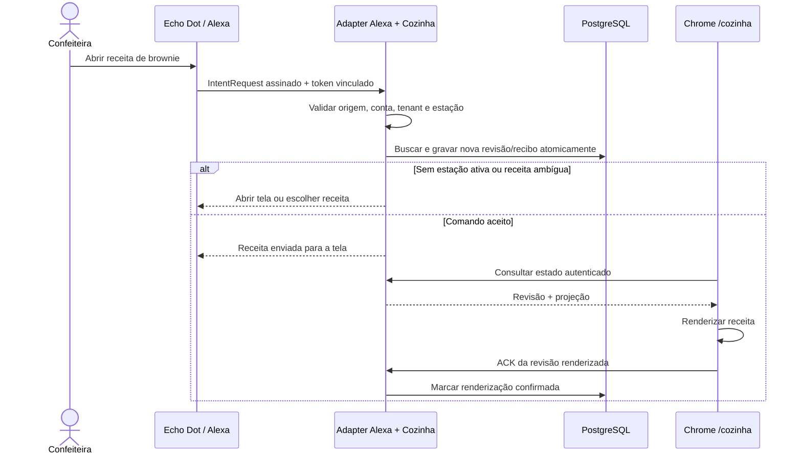

# F-COZ-01 — Modo cozinha com Alexa

Revisão 1 — 16/10/2026. Escopo, ID e divisão em quatro entregas aprovados pelo usuário nesta conversa. Desenho técnico r1 proposto para implementação; nenhuma integração implementada por este documento.

Fontes: [PRD](../../../prd.md), seção F-COZ-01; [contrato r1](contract.md); [plano](plan.md). Inspeção do working tree sobre HEAD `44835810044c912413f6dddd11a5c549a69bc791`. PRD anterior à extensão: SHA256 `C5D4AB7A112F4877B7F6D805EC7D067590A11EC916DFF122805EF13868ADD4E0`. Alterações de outros trabalhos preservadas.

## Objetivo e limites

A confeiteira consulta receitas e segue instruções sem tocar no computador durante o preparo. Echo Dot 3 captura comandos e fala; Chrome aberto no MacBook mostra conteúdo. O Mac é cliente web, não servidor, e não precisa executar reconhecimento de voz ou IA. Requer internet, navegador aberto e computador acordado.

Inclui busca, seleção entre resultados, ingredientes, preparo, montagem, avançar, voltar, repetir e retomada. Não inclui alterações de receitas, produção/estoque/pedidos, pagamentos, temporizadores, conversão de rendimento, reconhecimento pelo microfone do Mac, LLM, controle arbitrário do navegador ou execução de links por voz. Perguntas como “quanto vai de manteiga?” ficam para incremento posterior; o MVP lê a lista por partes.

## Evidências e dependências

| Fonte inspecionada | Existente | Consequência |
|---|---|---|
| `frontend/package.json` | Next 14.2.35, React 18, TanStack Query, Vitest, TypeScript | Reutilizar stack e hooks; nova rota proposta `/cozinha` |
| `backend/api/routers/receitas.py` | Consulta por ID e ficha técnica com tenant | Base de autorização; não precisa mudar contrato público de receitas |
| `backend/domain/receitas/central_snapshot.py` | Busca normalizada e projeção operacional com ingredientes, seções e versão | Reutilizar domínio, sem fazer chamada HTTP interna nem carregar custos na tela cozinha |
| `backend/api/routers/central_recipes.py` | Integração service-only `recipes.search/read` com principal/scope | Não expor credencial da Central à Alexa ou ao browser; manter contrato existente |
| `frontend/types/index.ts` | `modo_preparo` livre; etapas de tempo sem instrução; montagem em ficha | Não tratar etapas de tempo como passo a passo do preparo |
| `frontend/lib/api.ts`, `backend/api/dependencies.py` | Bearer/refresh existentes, ator e suporte administrativo distintos | Usar autenticação real; bloquear modo integrado durante impersonação |
| `backend/api/routers/auth.py` | Login/refresh; não é servidor OAuth authorization-code | Account linking demanda novo adapter OAuth limitado à cozinha |
| Inspeção dirigida de frontend/backend | Sem integração Alexa ou sincronização de estação encontrada | Provider externo e canal da tela ainda pendentes |

Dependências de produto: cadastro de receitas (§1 do PRD), AUTH-01/02/03 para identidade e FT-01/02 para montagem quando cadastrada. Não depende da Central WhatsApp disponível. Não alterar seus scopes, tokens ou payloads. IDs de receitas e ingredientes pertencem ao Fornada; IDs de skill, usuário Alexa, dispositivo e request pertencem à Amazon.

## Requisitos observáveis

| ID / aceite | Precondição e resultado obrigatório |
|---|---|
| B01 / AC1 | Usuária autenticada abre `/cozinha`, ativa estação, busca e seleciona receita por toque; lê ingredientes/preparo/montagem e usa avançar/voltar/repetir. Interface desktop e 390px sem rolagem horizontal. Botões com rótulos e texto ampliável. |
| B02 / AC2 | Vinculação exige consentimento da conta real Fornada e skill configurada. Usuária escolhe estação na interface. Um vínculo possui no máximo uma estação ativa; trocar exige ação na interface. Outra conta/dispositivo não herda acesso por semelhança de nome. |
| B03 / AC3 | Busca por nome ignora caixa/acentos. Zero resultados pede novo nome; um abre; vários oferecem até cinco opções numeradas por página. Escolha usa a lista salva da busca, nunca posição de uma consulta nova. Cancelar preserva receita atual. |
| B04 / AC4 | Alexa lê somente quantidades/unidades e nomes cadastrados, em partes numeradas. Não transforma volume em peso, soma sub-receitas nem altera rendimento. Falta de ingrediente/instrução é informada, sem completar receita por inferência. |
| B05 / AC5 | Abrir mostra ingredientes. Selecionar preparo ou montagem inicia no primeiro bloco. Avançar/voltar move um bloco; início/fim não ultrapassa limites. Repetir mantém posição. Voz e toque compartilham o mesmo estado. |
| B06 / AC6 | Encerrar sessão Alexa não encerra estação. Nova invocação retoma receita e posição ainda válidas. Refresh/reconexão busca o estado atual, não reproduz comandos antigos. Reiniciar API preserva estado persistido. |
| B07 / AC7 | Comando duplicado não avança duas vezes. Atualizações concorrentes têm ordem e conflito explícitos. Revisão antiga nunca substitui nova na tela. Autorização e vínculo são revalidados em cada comando. |
| B08 / AC7 | Sem heartbeat válido, Alexa pede para abrir/reativar tela e não altera navegação. Comando aceito pode dizer “enviado para a tela”; só pode dizer “exibido” após ACK de renderização da revisão correspondente. Não aguardar ACK indefinidamente no webhook. |
| B09 / AC7 | Logout/encerrar estação revoga sua lease e limpa conteúdo local. Vínculo revogado/usuário inativo não lê receita por voz. Outra conta/tenant não acessa estação, resultado, receita, estado, ACK ou comandos. |
| B10 / AC6 | Receita modificada bloqueia avanço/leitura até revisão por toque e recarga explícita; não mistura versões. Receita apagada/inacessível limpa projeção e pede outra receita. Sem rede, tela indica conteúdo desatualizado e desabilita operações remotas. |
| B11 / AC8 | Teste real registra Chrome/macOS, Echo, idioma, invocações reconhecidas, resultados visuais/voz, conectividade e cenário de ruído; falha de reconhecimento não altera estado por um comando inventado. |

Não é prometida escuta contínua da skill. Após timeout da Alexa pode ser preciso dizer “Alexa, peça ao Fornada…”. A retomada é estado do Fornada, não extensão ilimitada da sessão Alexa.

## Conteúdo navegável e leitura

Projeção própria da cozinha reaproveita busca/validação da projeção operacional. Versão é fingerprint da projeção; não confundir com número de versão do histórico de receitas. Fontes de blocos:

1. Ingredientes: lista raiz; montagem e sub-receitas continuam identificadas separadamente, sem consolidar quantidades.
2. Preparo: usar itens de lista ordenada de nível superior do Markdown quando o documento inteiro for essa lista; nos demais casos mostrar o texto completo como um bloco, preservando ordem e conteúdo. Não deduzir passos de frases. Markdown vazio não cria seção fictícia.
3. Montagem: um bloco por passo de `ficha_tecnica.passos` na ordem cadastrada; manter nominal, faixa, unidade, especificação e instrução. Etapas de tempo são contexto separado, não instruções inferidas.

Sub-receitas podem aparecer como seções identificadas fornecidas pela projeção operacional; navegação direta entre sub-receitas não é requisito do MVP. Links/imagens não são comandos, texto não confiável não vira SSML executável. Fala escapa XML, remove marcação e não lê URLs. Dividir fala em limites de itens/parágrafos, com fallback por palavras para conteúdo excessivo; “continuar” lê a próxima parte e “repetir” repete a atual. Texto integral permanece na tela. O contrato define limites técnicos propostos.

## Casos de borda

| Caso | Entrada/precondição | Resultado e verificação |
|---|---|---|
| E01 | Busca vazia, apenas espaços ou >200 caracteres | Rejeitar sem mudar estado; teste HTTP e intent, B03 |
| E02 | Zero, um, seis resultados ou nomes iguais | Nenhum/abertura/paginação; nome igual exige escolha, B03 |
| E03 | Escolha 0, negativa, maior que lista, sem lista ou lista vencida | Pedir nova busca/escolha válida sem abrir receita, B03 |
| E04 | Receita sem preparo, sem montagem ou ingrediente indisponível | Aviso explícito; não fabricar conteúdo, B04/B05 |
| E05 | Quantidade zero, negativa, não finita ou vínculo de outro tenant | Projeção rejeitada ou aviso de vínculo indisponível conforme domínio existente; nunca ler quantidade inválida, B04/B09 |
| E06 | Primeiro/último bloco e repetir | Mantém limite/posição; não conclui produção, B05 |
| E07 | Mesmo Alexa requestId ou command_id reenviado | Mesmo recibo, uma alteração; revalidar acesso antes de devolver recibo, B07 |
| E08 | Toque e voz concorrentes, ACK/resposta fora de ordem | CAS/serialização; conflito não vira retry cego; tela ignora revisão menor, B07 |
| E09 | Browser suspenso, aba fechada, Mac dormindo, internet caída | Lease vence; fala não confirma exibição; reconnect lê estado, B06/B08 |
| E10 | Duas abas tentam controlar uma estação | Uma lease; segunda informa estação em uso e só assume com ação explícita, B07/B08 |
| E11 | Refresh e nova sessão Alexa | Estado atual reaparece; sem redisparar anterior, B06 |
| E12 | Revogação, logout, token expirado, usuário inativo ou impersonação | Negar e limpar dados acessíveis; sem vazamento em cache/recibo, B09 |
| E13 | Receita alterada/apagada durante uso | Bloquear e pedir recarga/seleção; sem misturar versões, B10 |
| E14 | Markdown longo, XML/SSML, URLs ou imagem | Render seguro e fala escapada/dividida sem truncamento silencioso, B04 |
| E15 | Alexa Stop/Cancel, intent desconhecida, timeout | Stop encerra sessão de voz; cancel cancela seleção; desconhecida explica opções; estação preservada, B06 |
| E16 | Assinatura, timestamp, skill ID ou redirect OAuth inválido | Negar antes de consultar negócio; teste de fronteira, B02/B09 |

## Decisões técnicas propostas

- Polling HTTPS via TanStack Query em lugar de WebSocket/SSE: reutiliza Bearer/refresh existente e facilita Chrome antigo; exige medição de carga. Rota de estado só entrega projeção quando revisão muda. Página deve estar visível e reativar lease ao retornar; não depender de timers em segundo plano.
- PostgreSQL como fonte de estação, vínculo, revisão e recibos; Redis existente apenas para limites/estado OAuth transitório. Não usar sessão Alexa ou localStorage como fonte canônica. Reutilizar o login atual sem migrar sua forma de armazenamento nesta feature.
- Serviço determinístico de cozinha, adapter Alexa e adapter OAuth separados. Nova projeção explícita de blocos; reaproveitar regras do domínio de receitas e manter compatibilidade de `central_snapshot` e `central_recipes`.
- Alexa custom skill pt-BR com endpoint HTTPS do backend atual; sem novo serviço Lambda obrigatório. Verificação de assinatura/certificado/timestamp via SDK compatível a selecionar e fixar na implementação; não implementar criptografia ad hoc.
- OAuth authorization-code com tokens exclusivos e revogáveis `cozinha:read`/`cozinha:control`, sem scopes de mutação do ERP. Consentimento usa sessão existente e bloqueia suporte administrativo. Instalação/console Amazon e redirect URIs reais são dependências do piloto, não valores a inventar.
- Novas tabelas propostas: `cozinha_estacoes`, `cozinha_vinculos`, `cozinha_comandos`; credenciais e códigos OAuth em armazenamento próprio isolado. Aplicar tenant/UUID/timestamps/soft-delete conforme CLAUDE.md. Atualização estado+recibo na mesma transação; seleção e navegação com lock/CAS e unique request key. Lease evita dois browsers controlando a mesma estação.
- Migração aditiva Alembic, sem backfill de receitas. Rollback operacional desativa feature e revoga vínculos, preservando cadastros e estado; não fazer downgrade destrutivo com dados do piloto. Opt-in por tenant e feature flag desativada por padrão.

## Verificação e gates

| Cobertura | Fronteira e condição de passagem |
|---|---|
| AC1/B01 | Testing Library e browser: busca/toque e navegação utilizáveis em desktop/390px, alternativa ao uso de voz |
| AC2/B02/B09/E12/E16 | OAuth/webhook HTTP com duas contas/tenants: consentimento, código único, expiração, redirect allowlist, token limitado, revogação, assinatura inválida; zero leitura indevida |
| AC3/B03/E01–E03 | Fixtures sintéticas verificadas contra busca do provider existente; zero/um/vários, limites e lista estável |
| AC4/AC5/B04/B05/E04–E06/E14 | Projeção e intents reais: conteúdo cadastrado, blocos determinísticos, fala segura e ausência informada |
| AC6/AC7/B06–B10/E07–E13/E15 | API+DB e tela: concorrência, recibos, reinício, lease, ACK, versões, refresh/logout e reconexão |
| AC8/B11 | Echo real + Mac: evidência manual; simulador não substitui dispositivo nem ruído real |

| Gate | Fonte | Comando / cwd | Pré-requisito e política | Nesta tarefa |
|---|---|---|---|---|
| Backend | CLAUDE.md §10, pyproject.toml | `pytest --tb=short -q` / backend | PostgreSQL isolado migrado; banco com prefixo `fornada_central_test_` para suíte completa; obrigatório antes de commit de implementação | Não executado: documentação |
| Frontend | CLAUDE.md §10, package.json | `pnpm test --run` / frontend | Dependências instaladas; obrigatório antes de commit de implementação | Não executado |
| Tipos | CLAUDE.md §10 | `pnpm tsc --noEmit` / frontend | TypeScript; obrigatório antes de commit de implementação | Não executado |
| Lint/build | package.json | `pnpm lint`; `pnpm build` / frontend | Gates configurados; propostos para entrega integrada | Não executado |
| Backend lint | pyproject.toml | `ruff check` nos arquivos alterados / backend | Ruff configurado; proposto para implementação | Não executado |
| Whitespace/docs | Git e links locais | `git diff --check`; inspeção de links / raiz | Verificação leve dos artefatos | Executar ao concluir documentos |
| Integração real | Novo AC8 | Roteiro do plano | Conta Amazon, endpoint HTTPS, Echo e Mac; obrigatório para aceite do piloto | Pendente |

Cobertura obrigatória existente por módulo: services 80%, rotas 70%; motores custo 95%/precificação 95% só se afetados (não previsto). Não rodar testes contra banco compartilhado/produção. Não há workflow `.github` na inspeção; não afirmar CI configurada.

## Prontidão e riscos

Especificação pronta para orientar as quatro fatias; contrato técnico r1 é proposta explícita e pode ser refinado por compatibilidade real antes de congelar schemas. Nenhuma capacidade externa foi demonstrada nesta tarefa. Bloqueios do piloto: acesso à conta Amazon vinculada à Echo, skill pt-BR em development, credenciais/configuração OAuth e HTTPS, versão exata do Chrome, validação de fala em cozinha. Não bloqueiam iniciar a fatia local de modo cozinha.

Parâmetros do contrato são defaults técnicos propostos, não SLA aprovado. O teste de ruído registra reconhecimento por frase sem prometer taxa antecipada; o piloto só é aceito após a usuária executar busca, leitura e avanço sem toque no cenário real. Recursos de Wake Lock/fullscreen são opcionais; orientar ajuste manual de repouso, sem depender de suporte do browser.

Fontes oficiais consultadas em 16/10/2026: [web service e verificação](https://www.developer.amazon.com/en-US/docs/alexa/custom-skills/host-a-custom-skill-as-a-web-service.html), [sessões](https://developer.amazon.com/pt-BR/docs/alexa/custom-skills/manage-skill-session-and-session-attributes.html), [idioma e envelope](https://www.developer.amazon.com/en-US/docs/alexa/custom-skills/request-and-response-json-reference.html), [account linking](https://developer.amazon.com/docs/alexaplus/account-linking/account-linking-concepts.html), [authorization code](https://www.developer.amazon.com/docs/alexaplus/account-linking/configure-authorization-code-grant), [teste em dispositivo](https://developer.amazon.com/en-US/docs/alexa/test/test-your-skill-overview.html). Confirmar compatibilidade ASK clássica/pt-BR no console ao integrar; exemplos Alexa+ não são promessa de Alexa+ na Echo do piloto.
