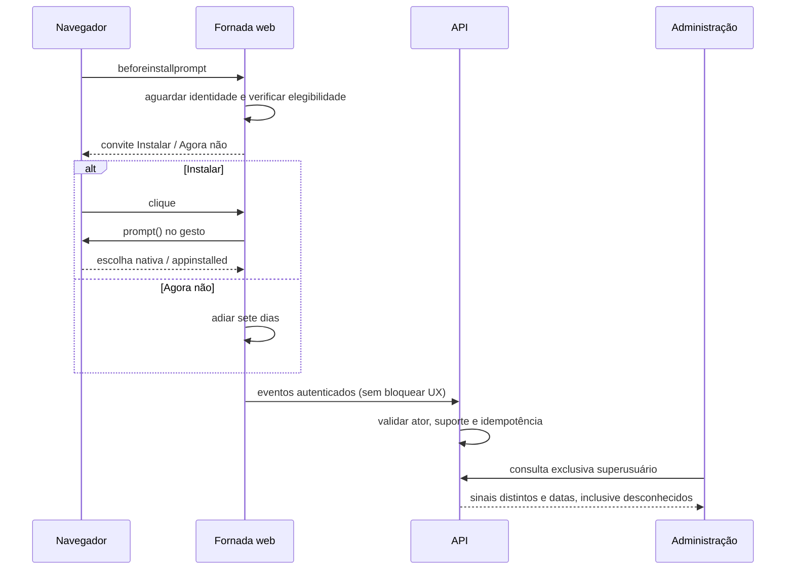

# F-PWA-01 — Convite de instalação e acompanhamento

Atualização de execução: implementação local concluída após aprovação do usuário; [resultados e limitações](implementacao.md). A tabela de gates abaixo registra o planejamento original; os resultados efetivamente executados estão no relatório. Aceite integrado Android real permanece pendente.

Revisão 1, 12/10/2026. Produto aprovado; desenho técnico proposto para revisão. Fontes: [PRD](../../../prd.md), seção F-PWA-01 de 12/10/2026; [contrato r1](contract.md); [plano](plan.md). Inspeção do working tree sobre HEAD `7acc29a8b424d30d5f54024a4a032c946b2de917`; alterações existentes preservadas. O hash original do PRD, antes desta extensão, era `CDA1041DD1BBCCE7CBE5FC0541EB5920FBD2EEA40F5189F7D645D40B401B3B8C`.

## Evidência e dependências

- `frontend/app/manifest.ts` e `frontend/app/layout.tsx`: identidade e manifesto existentes. Usuário confirmou PWA funcionando; não foi feita validação real de instalação nesta tarefa.
- `frontend/stores/use-auth-store.ts`, `frontend/app/(dashboard)/layout.tsx` e `frontend/tests/auth-hydration.test.tsx`: identidade persistida e espera por hidratação. Reutilizar sem mudar autenticação.
- `frontend/app/providers.tsx`: ponto global para capturar evento antes da navegação; convite somente na área autenticada.
- `frontend/lib/api.ts` e `frontend/lib/admin-session.ts`: JWT e header de suporte; nunca atribuir suporte à adoção do cliente.
- `backend/api/dependencies.py`: ator real, usuário efetivo e superusuário distintos. `backend/api/routers/admin.py`, `frontend/hooks/use-admin.ts`, `frontend/app/(dashboard)/admin/page.tsx`: diretório global restrito existente.
- Dependências: identidade de AUTH-01/02/03 e administração ADM-01, implementadas nas partes inspecionadas; não requer mudar seus contratos. Não existe contrato local de telemetria PWA: esta feature é a provedora, conforme contrato r1. Backend de eventos e consulta administrativa ainda não implementados.

## Comportamento

| Requisito | Condição e resultado verificável |
|---|---|
| B1 / AC1 | Após hidratação, autenticação e identidade presentes, oferecer uma vez por sessão autenticada quando houver evento nativo disponível; evento tardio ainda pode habilitar oferta. Sem usuário, sem convite ou telemetria. |
| B2 / AC2 | Clique em Instalar chama confirmação nativa diretamente pelo gesto; aguardar telemetria antes disso é proibido. Registrar escolha accepted/dismissed separada do sinal appinstalled. Texto não promete download de APK. |
| B3 / AC3 | Agora não, Escape ou fechar adiam oferta automática por 7×24h. Antes do limite não oferecer; no limite ou após, elegível em nova sessão. Navegar entre páginas não reabre. |
| B4 / AC4 | Menu permite tentativa manual durante adiamento se houver evento disponível. Em standalone/fullscreen ou suporte não oferecer instalação. Sem evento: não exibir botão acionável nem modal automático. |
| B5 / AC5 | Persistir sinais definidos no contrato com identidade autenticada e timestamp do servidor. Acesso standalone/fullscreen é sinal de uso, emitido uma vez por sessão autenticada nesse modo; não é prova de instalação permanente. |
| B6 / AC6 | Administração lista usuários inclusive sem eventos; exibe separadamente últimas datas e contagens de sinais. “Sem confirmação” significa ausência de evidência. Não inferir desinstalação nem concluir que visita web significa app ausente. |
| B7 / AC7 | Backend deriva usuário/tenant do ator; rejeita suporte e identidade fornecida no payload. Leituras comuns não acessam dados alheios. Consulta global exclusiva de superusuário explícito. |
| B8 / AC8 | Erro de prompt permite continuar ERP e informa “Não foi possível abrir a instalação. Tente novamente pelo menu.” Falha de telemetria não bloqueia login, navegação ou instalação. Armazenamento indisponível mantém apenas controle em memória da sessão. |

## Decisões técnicas propostas

Listener tipado global de beforeinstallprompt/appinstalled, sem dependência nova, mantém evento em memória e não o serializa. Consumir cada evento de instalação no máximo uma vez; nova tentativa exige novo evento do navegador. Capturar cedo, exibir tarde. Não alterar service worker/cache nesta feature.

Adiamento local usa chave por tenant/usuário e identificador aleatório do navegador (UUID, sem fingerprint). Não sincronizar adiamento entre aparelhos. Não suprimir oferta em outro aparelho porque houve instalação anterior. Logout limpa estado em memória e eventos pendentes vinculados à sessão, preservando adiamento local. Recarregar página inicia nova sessão de observação, respeitando adiamento; renovação de token não inicia nova sessão.

Persistência proposta: tabela de eventos com convenções existentes de UUID, tenant_id, usuario_id, created_at, updated_at e deleted_at; timestamp de recepção, UUID de evento, browser_id e session_id aleatórios, tipo enumerado. Sem IP, user-agent bruto, segredos ou fingerprint armazenados por esta feature. Índice único de idempotência e índices de agregação por tenant/usuário/tipo/data. Inserção atômica; não inferir sequência causal pela ordem de chegada. Consulta calcula agregados, evitando segunda fonte de estado.

Retenção e volume não possuem meta aprovada; MVP não promete SLO quantitativo nem exclusão automática. Antes de ampliar coleta ou adotar retenção automática, definir política. Migration aditiva gerada por Alembic e ensaiada em banco isolado. Rollback de código pode deixar tabela inerte; não apagar eventos de produção para reverter código.

## Sequência

## Casos de borda e evidência de aceite

| Caso | Entrada / condição | Resultado e verificação |
|---|---|---|
| E1 | Hidratação incompleta; login email ou WhatsApp | B1: nenhum convite antecipado; teste de layout e integração dos dois acessos |
| E2 | Evento antes/depois do login; navegador sem suporte | B1/B4: capturar antecipado, aguardar tardio; sem evento não oferecer; Testing Library |
| E3 | Agora não; t=7 dias menos 1ms / t=7 dias | B3: oculto / elegível em nova sessão; relógio controlado |
| E4 | Escape, clique fora, navegação e renovação JWT | B3: fechar adia; não repetir na mesma sessão; teste UI |
| E5 | Clique duplo, recusa, prompt rejeitado | B2/B8: uma chamada por evento; sem sucesso inventado; teste com adapter do navegador |
| E6 | Standalone, fullscreen, visita web após instalação, outro aparelho | B4/B5/B6: modos app ocultam oferta e registram uso; visita web não apaga sinais; outro aparelho independente |
| E7 | Troca de conta/logout; armazenamento bloqueado | B7/B8: sem herdar eventos de outra conta; em memória não repetir na sessão; teste UI/API |
| E8 | Duplicata igual/diferente, concorrência, eventos fora de ordem | B5: contrato 200/409; uma linha por chave; agregados por sinal; PostgreSQL isolado |
| E9 | Payload vazio, UUID inválido, tipo desconhecido, campos extras | B7: 422 sem escrita; contrato/API |
| E10 | Sem token, usuário comum consultando admin, suporte ativo | B7: 401/403 sem coleta indevida; API com dois tenants e superusuário |
| E11 | API indisponível, logout enquanto envio aguarda | B8/B7: ERP utilizável; descartar retry de sessão antiga; UI com falha de rede |
| E12 | Usuário sem eventos; aceitou sem appinstalled; appinstalled sem clique | B6: mostrar desconhecido e sinais independentes; teste de agregação e painel |

Valores monetários, quantidades e limites numéricos de negócio não se aplicam. Limites de paginação/UUID estão no contrato.

## Gates

| Gate | Fonte | Comando / cwd | Pré-requisito e política | Execução |
|---|---|---|---|---|
| Backend regressão | CLAUDE.md §10; backend/pyproject.toml | `pytest --tb=short -q` / backend | dependências e PostgreSQL exclusivo de teste com migrations; obrigatório antes de commit | não executado; apenas documentos |
| Frontend regressão | CLAUDE.md §10; frontend/package.json | `pnpm test --run` / frontend | dependências instaladas; obrigatório antes de commit | não executado |
| TypeScript | CLAUDE.md §10 | `pnpm tsc --noEmit` / frontend | dependências; obrigatório antes de commit | não executado |
| Build | frontend/package.json | `pnpm build` / frontend | ambiente build; gate proposto de entrega | não executado |
| Diff | Git | `git diff --check -- prd.md docs/features/F-PWA-01-instalacao` / raiz | gate documental proposto | registrar resultado na entrega |
| Mobile real | CLAUDE.md §14 + AC2 | Chrome Android e viewport 390px, roteiro E1–E6 | instalação real, email/WhatsApp e painel; obrigatório para aceite integrado | pendente; mocks não comprovam instalação |

Sem CI em `.github` encontrada. Não há evidência de testes verdes nesta formalização. Ready para implementação após revisão do contrato e granularidade dos tickets; aceite integrado depende da validação real do provedor navegador. Não alterar produção, aplicar migration ou publicar nesta fase.
